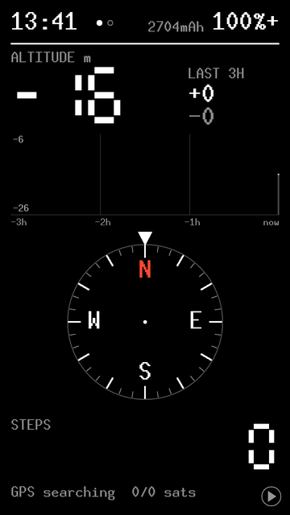

# nexus5x-hike-buddy

**Hike Buddy**: a Garmin-style hiking console for the Nexus 5X (bullhead). No
Android: just the Linux kernel, a tiny init and one daemon (`hike-buddy`)
with a minui front end. Booted recovery-style and tested only with
`fastboot boot`, so nothing is flashed and the phone's Android stays as is.

Captured from the phone's framebuffer with `scripts/screencap.py` (demo mode, so no real position is shown).

## What it shows

- **Main page:** clock, charge left (mAh) and battery %; barometric altitude
  with a 3-hour profile and climb/descent; compass rose; step count; GPS
  status.
- **Map page:** offline OpenStreetMap for Tokyo + Kanagawa (trails, tracks,
  main roads, rail, water, peaks, huts, springs, stations); drag to pan,
  +/- or volume keys to zoom, the target button follows the GPS position.
- **Battery log** (no page): where the charge went by mode and part, written
  to `/tmp` and read with `scripts/power-report.sh`.

## Layout

Each folder has its own README.

| Path | What |
|---|---|
| [`hike-buddy/`](hike-buddy/) | the daemon: UI, sensor hub client, QMI LOC GPS client, map renderer, battery accounting |
| [`rootfs/`](rootfs/) | `init`, `inittab` and the boot-time shell scripts packed into the ramdisk |
| [`scripts/`](scripts/) | PC-side build and dev helpers (kernel, boot image, phone shell, clock, power report) |
| [`tools/`](tools/) | small phone helpers (`hike-buddy-reboot`, the `rmt_storage` props shim) and the map builder |
| [`config/`](config/) | kernel config fragment merged onto `bullhead_defconfig` |
| [`patches/`](patches/) | kernel commits exported for publishing |
| [`docs/`](docs/) | longer design notes |
| `kernel/` | separate git clone of LineageOS's bullhead kernel (3.10), branch **`hike-buddy`**; not tracked here (see Requirements) |
| `out/` | everything built or downloaded (not tracked) |

Nothing writes to the phone's partitions (the modem's own `rmt_storage`
writes to its modemst areas, as on every Android boot).

## Hardware facts that drive the design

- **The panel is an IPS LCD** (JD35695B, 1080p): black pixels do *not* save
  power, the backlight dominates.
- **Sensor hub** (STM32 nanohub, open-source AOSP firmware) owns the
  accelerometer, magnetometer and BMP280 barometer. Steps are counted and
  the barometer sampled while the main CPU sleeps; heading is fused on the
  hub from accelerometer + magnetometer.
- **GPS lives in the modem**: the modem is booted by the kernel, `rmt_storage`
  serves its storage, and fixes come over QMI LOC on the IPC router. The
  setup replays what Android sends; the modem accepts time injection but
  rejects today's XTRA files (under Android too).
- **userdata is encrypted** (full-disk encryption), so `/tmp` (RAM) is the
  only writable storage: the clock and logs are lost on reboot.

## Requirements

**No LineageOS and no Android build tools needed.** This project was
developed on a phone running LineageOS 15.1, with a LineageOS source tree on
the PC, simply because that setup already existed. Neither is required:

- **On the PC**, everything that runs on the phone is built with a stock
  Linux cross compiler and glibc (`hike-buddy` uses only plain Linux
  interfaces). The one piece loaded into an Android binary, the
  `rmt_storage` props shim, is built freestanding (no libc at all), so no
  bionic or NDK is involved. The only old tool is **GCC 4.9 for the 3.10
  kernel**, which current GCCs can't build: `scripts/fetch-toolchains.sh`
  takes it from AOSP (the same build LineageOS ships; a LineageOS/AOSP 8.1
  tree's copy works too, `LINEAGE=`).
- **On the phone**, any **Android 8.x install for bullhead** works, Google's
  factory image or LineageOS, with an **unlocked bootloader** (for
  `fastboot boot`). The hike image reads, read-only, what every bullhead
  Android ships: the modem firmware (`modem` partition) and two Qualcomm
  helpers in `/system` (`rmt_storage`, `irsc_util` + `/system/etc/sec_config`).
  Nothing is flashed or installed; the installed Android keeps working.

What the build does need:

- **PC tools**: `g++-aarch64-linux-gnu` (Debian/Ubuntu package, brings
  `gcc-aarch64-linux-gnu` and the static glibc), `make`, `git`, `curl`,
  `fastboot`, Python 3; `g++` for the screen preview; `osmium` + `shapely`
  for the map builder (see `tools/map/`).
- **Kernel source**: LineageOS's bullhead kernel (the public kernel repo
  only, not the whole tree) with the patches from `patches/`:

      git clone -b lineage-15.1 https://github.com/LineageOS/android_kernel_lge_bullhead kernel
      git -C kernel checkout -b hike-buddy
      git -C kernel am ../patches/*.patch

  It is Google's `android-msm-bullhead-3.10` kernel plus LineageOS fixes.
- **A static aarch64 busybox** binary (init, shell and the dev tools).

Machine-specific settings go in an untracked `local.env` at the repo root:

    BUSYBOX=/path/to/busybox            # required
    # LINEAGE=/path/to/lineage-15.1     # take the kernel GCC from that tree
    # KCROSS=/path/to/aarch64-...-      # or any aarch64 GCC 4.9 prefix
    # CROSS=aarch64-linux-gnu-          # the userspace cross compiler (default)

## Build and run

    scripts/fetch-toolchains.sh        # once: kernel GCC 4.9 from AOSP -> out/toolchains/
    scripts/build-kernel.sh            # -> out/kobj/arch/arm64/boot/Image.gz-dtb
    scripts/build-bootimg.sh           # -> out/hike-buddy-boot.img (builds hike-buddy too)
    fastboot boot out/hike-buddy-boot.img   # RAM only
    scripts/set-time.sh                # give it the time (else the first GPS fix sets it)

Screen preview on the PC: `make -C hike-buddy/preview && out/preview/preview 247 8432 out/screen.ppm`.
Dev shell: `scripts/phone.py 'dmesg | grep hike-buddy'`.
